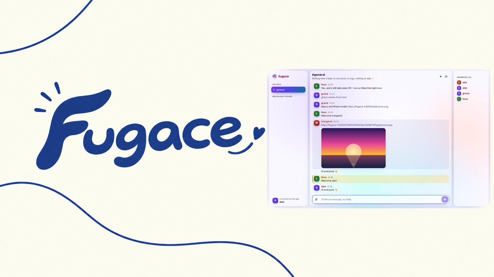
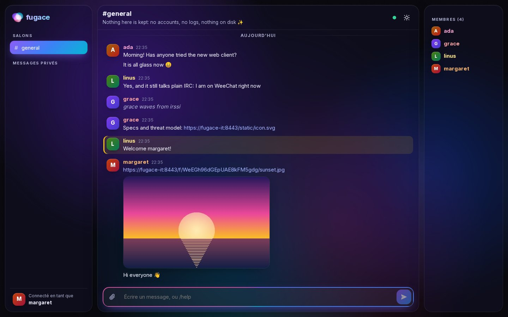
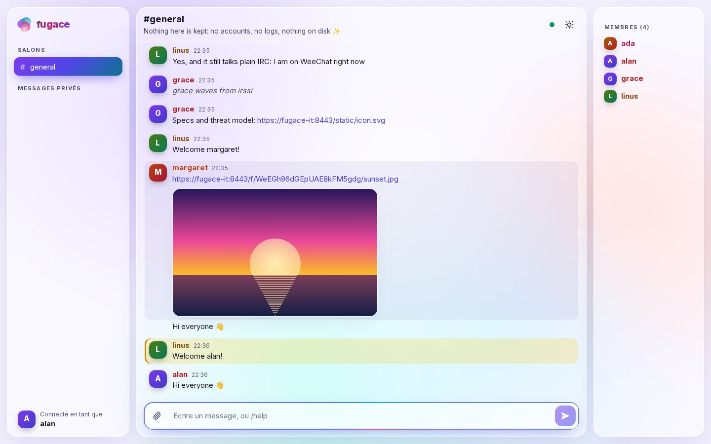
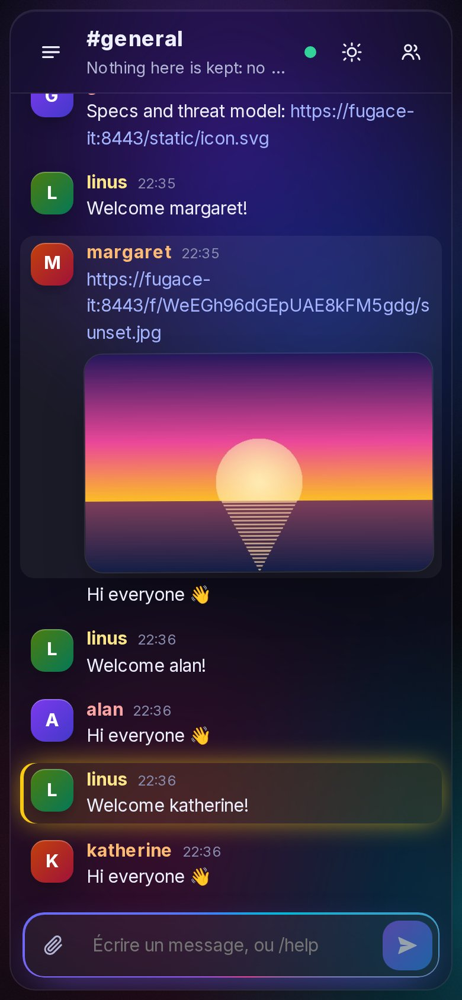

<p align="center">
  
</p>

<p align="center">
  <a href="https://github.com/gabltz/fugace/actions/workflows/ci.yml"></a>
  <a href="https://github.com/gabltz/fugace/releases"></a>
  <a href="go.mod"></a>
  <a href="https://pkg.go.dev/github.com/gabltz/fugace"></a>
  <a href="LICENSE"></a>
</p>
<p align="center">
  <a href="https://github.com/gabltz/fugace/pkgs/container/fugace"></a>
  
  
  <a href="#verify-the-image"></a>
  <a href="go.mod"></a>
</p>
<p align="center">
  
  
  <a href="https://github.com/gabltz/fugace/commits/main"></a>
  <a href="https://github.com/gabltz/fugace/issues"></a>
  <a href="https://github.com/gabltz/fugace/stargazers"></a>
</p>

<p align="center">
  <b>A chat server that forgets.</b> No accounts, no logs, nothing written to disk.<br>
  A built-in glass-and-aurora web client <i>and</i> plain IRC for WeeChat, irssi, HexChat…, image and file sharing,<br>
  HTTPS out of the box, all in one static Go binary inside a ~13 MB <code>scratch</code> image. Delete the container: everything is gone.
</p>

<p align="center">
  <a href="#quick-start">Quick start</a> ·
  <a href="#features">Features</a> ·
  <a href="#configuration">Configuration</a> ·
  <a href="#security-and-privacy">Security</a> ·
  <a href="#verify-the-image">Verify</a> ·
  <a href="#development">Development</a>
</p>

---

<p align="center">
  
</p>
<table>
  <tr>
    <td width="68%"></td>
    <td width="32%"></td>
  </tr>
</table>

## Why fugace?

Most chat tools remember everything: accounts, logs, histories, metadata. fugace is built for the opposite, a room for a group that wants to talk *now* and leave nothing behind.

- **Zero configuration.** `docker run` and you have HTTPS, a web client and an IRC server.
- **Ephemeral by construction.** State lives in RAM only. The root filesystem is read-only, the process writes nothing and logs nothing. Restarting gives you a blank slate.
- **Private by default.** No IP address is ever shown to other users or stored in clear. Images are re-encoded to strip EXIF and GPS data, and DCC is blocked because it would leak addresses.
- **Small and auditable.** One Go binary, 3 dependencies, a strict CSP, fuzzed parsers, and a written [threat model](docs/THREAT_MODEL.md) where every threat maps to a test.

## Quick start

```sh
curl -fsSL https://github.com/gabltz/fugace/releases/latest/download/install.sh | bash
```

That's all you need: Docker plus this one line, and no clone. The installer offers to **install**, **reinstall from scratch** or **uninstall**, then:

- **Configuration.** It walks you through every setting. Press Enter to keep the default; leave the host empty for local-only use (self-signed HTTPS on your network).
- **Image.** It pulls the latest official image and checks its signature if `cosign` is installed.
- **Container.** It starts fugace with every hardening option (read-only, no capabilities, no logs, no swap) and waits until it is healthy.

<details>
<summary>Read the script first, or run it unattended</summary>

```sh
curl -fsSLO https://github.com/gabltz/fugace/releases/latest/download/install.sh
curl -fsSL https://github.com/gabltz/fugace/releases/latest/download/install.sh.sha256 | sha256sum -c
less install.sh && bash install.sh

# Unattended: answers come from FUGACE_* variables, everything else keeps its default
FUGACE_HOST=chat.example.org FUGACE_ADMIN_PASSWORD='change-me-please' bash install.sh --install --yes
```

`install.sh --help` lists the options (`--install`, `--reinstall`, `--uninstall`, `--yes`, `--version`).
</details>

Prefer plain Docker? This is equivalent to the defaults:

```sh
docker run -d --name fugace --read-only --cap-drop ALL --security-opt no-new-privileges:true \
  --log-driver none -p 80:8080 -p 443:8443 -p 6667:6667 -p 6697:6697 \
  ghcr.io/gabltz/fugace:0.3
```

Or, from a clone of this repository, with every hardening option preset (no swap, pids and file limits, `logging: none`):

```sh
docker compose up -d --build
```

Then open:

- **Web**: `https://<your-ip-or-domain>`. Port 80 redirects to 443, no reverse proxy needed.
- **IRC**: `<host>:6697` (TLS, same certificate as the web) or `<host>:6667` (plain text).

`#general` exists from the start and the web client joins it automatically. To start from scratch (history, files, self-signed certificate), recreate the container: `docker compose up -d --force-recreate`.

### From an IRC client

```text
WeeChat   /server add fugace chat.example.org/6697 -tls
          /connect fugace
irssi     /connect -tls chat.example.org 6697
```

With a self-signed certificate, disable certificate verification in your client or trust the certificate first. Any nickname works; there is nothing to register.

## Features

| | |
|---|---|
| **Chat** | Channels and private messages, `/me`, topics. IRCv3 `server-time`, `echo-message`, `message-tags`, `draft/message-redaction`. Verified with real WeeChat and irssi in CI |
| **Web client** | Vanilla JS with no build step and no third-party request. Glass panels over an animated aurora, dark and light themes that follow your system, spring animations, view transitions, image lightbox, drag-and-drop and paste uploads. Full/reduced motion setting that honours `prefers-reduced-motion`. Mobile-ready |
| **Your messages, your call** | Delete any of your own messages, in channels and private messages, for everyone and from the history (IRCv3 `draft/message-redaction`). A profile picture, kept in RAM only while you are connected. **Clear account** (bottom left in the web client, `/clear-account` from IRC, `/quote CLEARACCOUNT` in WeeChat) erases your messages, files and picture, then disconnects you. No account: the web client keeps a random key in your browser, the server only a keyed hash of it |
| **History** | Each channel keeps, in RAM only, everything said since the server started (global memory budget, oldest first out) and replays it, with original timestamps, to whoever joins. There is no history of private messages |
| **Files & images** | Up to 10 MB per file and 256 MB in total, deleted after 1 hour. JPEG, PNG, animated GIF and WebP are re-encoded (EXIF and GPS removed, orientation kept). Everything else, SVG included, is served as a download, never rendered |
| **HTTPS** | Mounted certificate > Let's Encrypt for your domain > self-signed in RAM. The same certificate serves IRC over TLS. Renewed automatically, with a ≥ 1 h back-off on failure so a rate limit never locks you out |
| **Moderation** | An optional admin creates and deletes channels and clears their history. An optional server password gates entry |
| **Operations** | One line on startup, then silence. `fugace status` answers on demand. A healthcheck is built in |

> The web interface is currently in **French**. IRC clients are unaffected.

## Configuration

Everything is optional; with no variable at all you get self-signed HTTPS on any IP.

| Variable | Default | Purpose |
|----------|---------|---------|
| `FUGACE_HOST` | empty | Domain(s) for a Let's Encrypt certificate. IP addresses only extend the self-signed certificate. Also the base of file URLs |
| `FUGACE_TLS` | `auto` | `auto` (mounted > ACME > self-signed) or `off` (plain HTTP on 8080, behind your own proxy) |
| `FUGACE_CERT_CACHE` | empty | Volume that keeps the ACME account and certificate across re-creations |
| `FUGACE_PASSWORD` | empty | Shared server password (IRC `PASS`, a field in the web client) |
| `FUGACE_ADMIN_PASSWORD` | empty | Admin password, at least 8 characters (empty: no admin) |
| `FUGACE_CHANNELS` | `#general` | Channels created at startup |
| `FUGACE_HISTORY_MAX_MB` | `64` | RAM budget for channel history (`0` disables history) |
| `FUGACE_MAX_UPLOAD_MB` / `FUGACE_FILES_MAX_MB` / `FUGACE_FILE_TTL` | `10` / `256` / `1h` | File limits |
| `FUGACE_PUBLIC_URL` | empty | Base of file URLs when clients see another host name |
| `FUGACE_TRUSTED_PROXIES` | empty | CIDRs whose `X-Forwarded-For` is trusted (per-source limits only) |
| `FUGACE_HTTP_ADDR`, `FUGACE_HTTPS_ADDR`, `FUGACE_IRC_ADDR`, `FUGACE_IRCS_ADDR` | `:8080`, `:8443`, `:6667`, `:6697` | Listen addresses. An empty IRC address disables that listener |
| `FUGACE_ACME_DIRECTORY` | Let's Encrypt | ACME directory URL (staging, test CA) |

An invalid value stops the server at startup with a clear message and exit code 2. The message never echoes the value, in case it is a secret.

### Certificates

| Situation | What to do | Result |
|-----------|------------|--------|
| LAN, access by IP | nothing | Self-signed certificate generated in RAM. Accept the browser warning once |
| Same, with the IP in the certificate | `FUGACE_HOST=192.168.1.20` | Self-signed, valid for that IP |
| A domain pointing to the host | `FUGACE_HOST=chat.example.org` | Let's Encrypt certificate obtained at startup and renewed at half-life |
| Your own certificate | mount `./certs:/certs:ro` with `tls.crt` and `tls.key` | Used first, reloaded when it changes |
| Your own reverse proxy | `FUGACE_TLS=off` | Plain HTTP on port 8080 |

**Domains:**

- **Reachability.** Ports 80 and 443 of the host must be reachable from the Internet; forward them if you are behind a NAT.
- **Rate limits.** Let's Encrypt allows 5 certificates per week for the same set of names, and every container re-creation asks for one. On failure, fugace falls back to self-signed at once and retries no earlier than one hour later, honouring `Retry-After`.
- **Caching.** Set `FUGACE_CERT_CACHE=/cache` with a volume to keep the certificate across re-creations. The files are mode 0600 and contain no user data. This is the only disk write fugace can ever make, and only when you ask for it.
- **IP addresses.** No public certificate is ever requested for an IP address: access by IP is meant for local networks.

Nothing is logged, so the state is available on demand:

```console
$ docker exec fugace /fugace status
tls:         acme
certificate: valid until 2027-01-17T09:12:44Z (publicly trusted)
connections: 12
```

### Admin and channels

- **Becoming admin.** Set `FUGACE_ADMIN_PASSWORD`, then use **Options → Mot de passe admin** in the web client, or `/oper admin <password>` on IRC. The admin shows as `@`.
- **Managing channels.**
  - `/join #new` creates a channel; only the admin can create channels, and they persist even when empty;
  - `/delchan #channel [reason]` deletes it with its history;
  - `/clearhistory #channel` clears its history.

### Files from an IRC client

Each IRC connection gets its own upload token, announced in `005` as `fugace/UPLOAD=<token>`. It is valid while that connection stays open:

```sh
curl -k -H "Authorization: Bearer <token>" --data-binary @photo.jpg "https://<host>/upload?name=photo.jpg"
```

The JSON reply contains the URL to paste in the channel.

## Security and privacy

fugace is designed against the threats listed in [`docs/THREAT_MODEL.md`](docs/THREAT_MODEL.md), from seizure of the host after the fact to malicious uploads, XSS, flooding and slowloris. Each of them is covered by named tests. Highlights:

- **Nothing on disk, nothing logged.**
  - The rootfs is read-only and `docker diff` stays empty; CI checks this after real traffic;
  - stdout carries exactly one startup line;
  - panics are recovered without printing anything.
- **No addresses.** Hostmasks are fixed (`nick!~user@fugace`), and `WHOIS` and `WHO` show no IP and no idle time. Per-source limits use `HMAC-SHA256(per-boot random key, IP)`.
- **Uploads.**
  - Content-sniffed and size-capped;
  - decompression bombs are refused before decoding;
  - images are re-encoded, everything else is sent as an attachment with `nosniff` and a sandboxing CSP;
  - upload tokens die with their connection.
- **Web.** Strict CSP with no inline code, text rendered only through `textContent`, same-origin WebSocket check, and no third-party resource at all. A headless browser runs XSS payloads and axe-core in CI.
- **Abuse limits.**
  - fake-lag flood control and bounded send queues;
  - per-source connection caps on IRC, WebSocket and HTTP;
  - see [`docs/BENCH.md`](docs/BENCH.md): 500 clients at 50 msg/s with no message lost and a p99 latency of 2.9 ms.

**Known limits.**

- Your IRC client probably logs locally, which is out of the server's hands.
- Port 6667 is plain text; prefer 6697 or the web client.
- While the container runs, RAM holds the channel history and the last hour of files; a root user on the host can read it.
- A self-signed certificate can be impersonated if users click through the warning without checking.
- Let's Encrypt certificates are published in Certificate Transparency logs.
- Without `FUGACE_PASSWORD`, anyone can join.

To report a vulnerability, see [SECURITY.md](SECURITY.md).

## Verify the image

Every release is built for amd64 and arm64 and signed keylessly with [cosign](https://github.com/sigstore/cosign). It ships with an SBOM and a SLSA provenance attestation:

```sh
cosign verify ghcr.io/gabltz/fugace:0.3 \
  --certificate-identity-regexp 'https://github.com/gabltz/fugace/.github/workflows/release.yml@refs/tags/v.*' \
  --certificate-oidc-issuer https://token.actions.githubusercontent.com

docker buildx imagetools inspect ghcr.io/gabltz/fugace:0.3 --format '{{json .SBOM}}'
```

Before anything is pushed, the release workflow tests the tagged commit again and scans it with Trivy. After publishing, it checks the signature and runs the smoke test on both architectures from the registry.

## How it works

```
                ┌──────────────────── fugace (one static binary) ───────────────────┐
 host:80   → 8080 ┤ HTTP   301 → HTTPS · ACME http-01 · /healthz                       │
 host:443  → 8443 ┤ HTTPS  web client · /ws (IRC over WebSocket) · uploads · files    │
 host:6667 → 6667 ┤ IRC    ─┐                                                          │
 host:6697 → 6697 ┤ IRC/TLS ┴─► one IRC core: clients, channels, history (RAM)         │
                  │ certificates: mounted > Let's Encrypt (domains) > self-signed      │
 127.0.0.1:9090   ┤ internal status (never published)                                  │
                  └─────────────────────────────────────────────────────────────────────┘
```

The web client speaks IRC over WebSocket (`text.ircv3.net`), so there is a single protocol and a single parser on the server. The design documents, in French, are in [`docs/`](docs/README.md):

- [specification](docs/SPEC.md), [architecture](docs/ARCHITECTURE.md) and [threat model](docs/THREAT_MODEL.md);
- [decision records](docs/adr/), [roadmap](docs/ROADMAP.md) and [benchmarks](docs/BENCH.md).

## Development

You need Go 1.27, Docker, and [golangci-lint](https://golangci-lint.run/) v2.

```sh
make check     # golangci-lint, go test -race, govulncheck
make fuzz      # every fuzz target (IRC lines, config, images, file names, X-Forwarded-For)
make smoke     # container: HTTPS, IRC, upload, empty docker diff, silent output
make clients   # real WeeChat and irssi against the image
make browser   # headless Chromium: XSS payloads, CSP, axe-core, uploads, mobile
make acme      # Let's Encrypt flow against pebble
```

CI runs all of the above on every pull request, together with Trivy, supply-chain checks (actions pinned by SHA, images pinned by digest, at most 3 dependencies) and a container-hardening check. Contribution rules are in [CONTRIBUTING.md](CONTRIBUTING.md).

## License

fugace is free software under the [GNU Affero General Public License v3.0](LICENSE). If you run a modified version as a network service, you must offer its source to its users.

The web client embeds the [Inter](https://github.com/rsms/inter) typeface under the SIL Open Font License 1.1; see [THIRD_PARTY_NOTICES.md](THIRD_PARTY_NOTICES.md).
